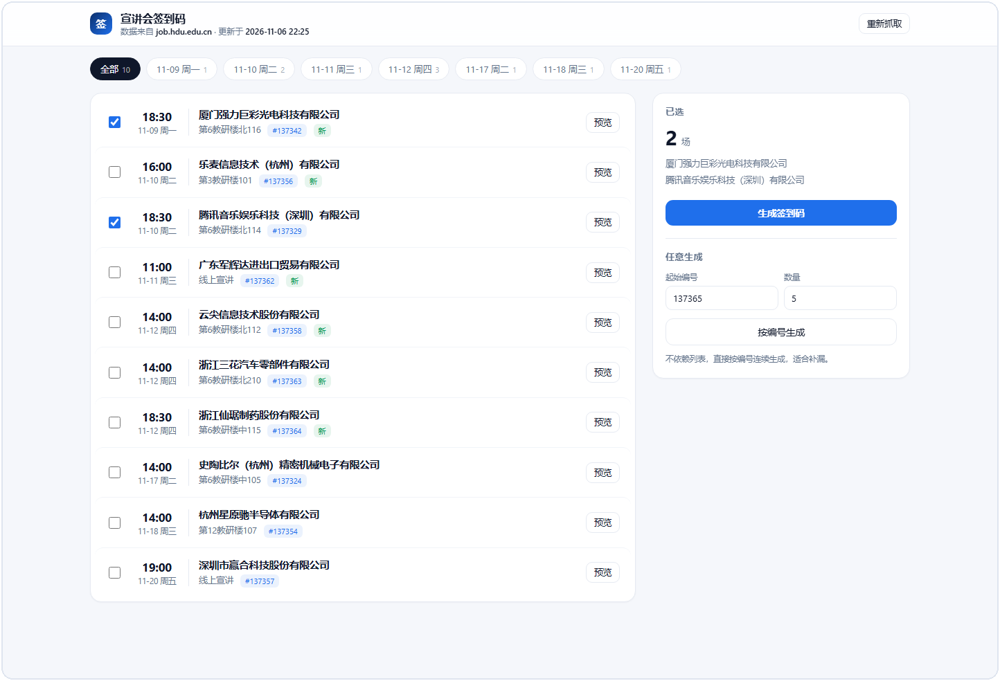
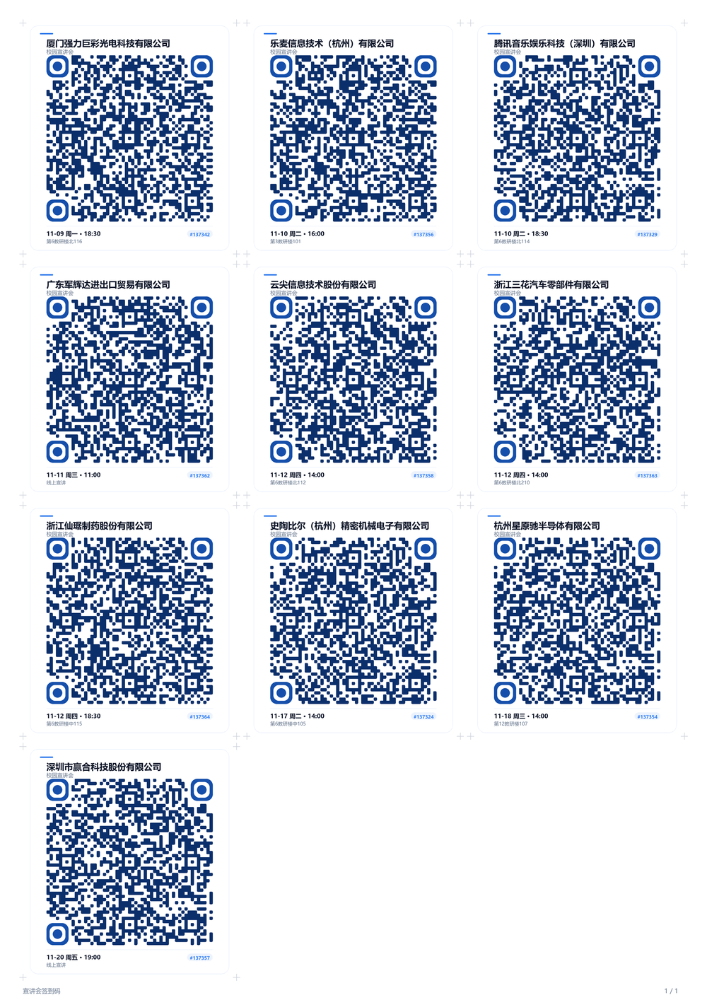
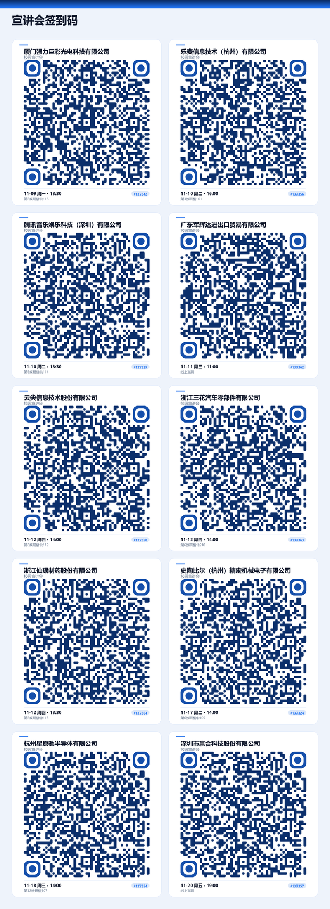
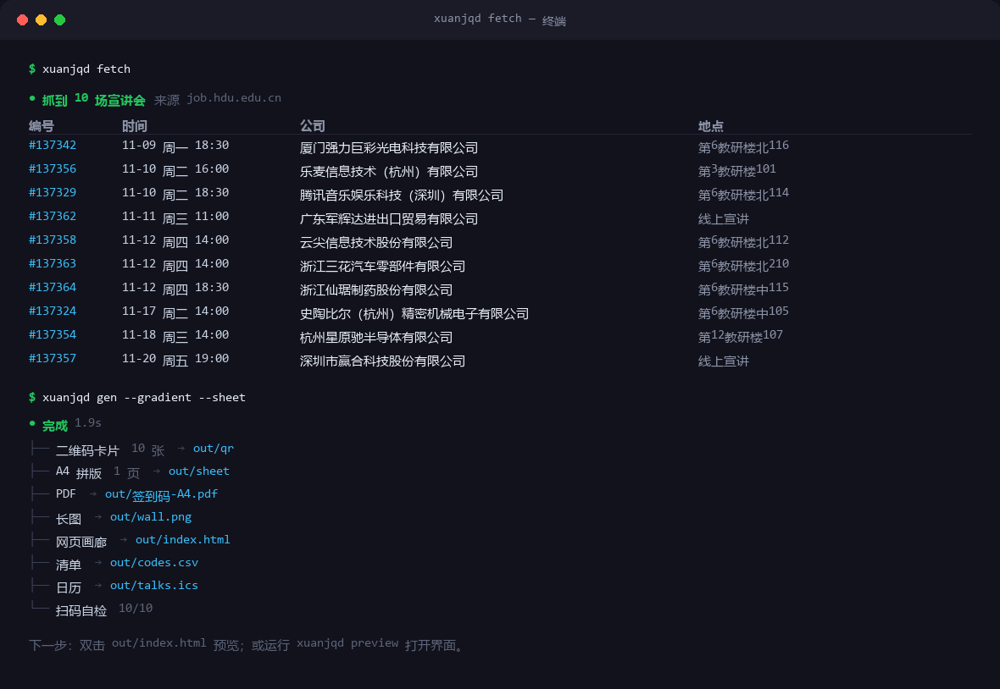
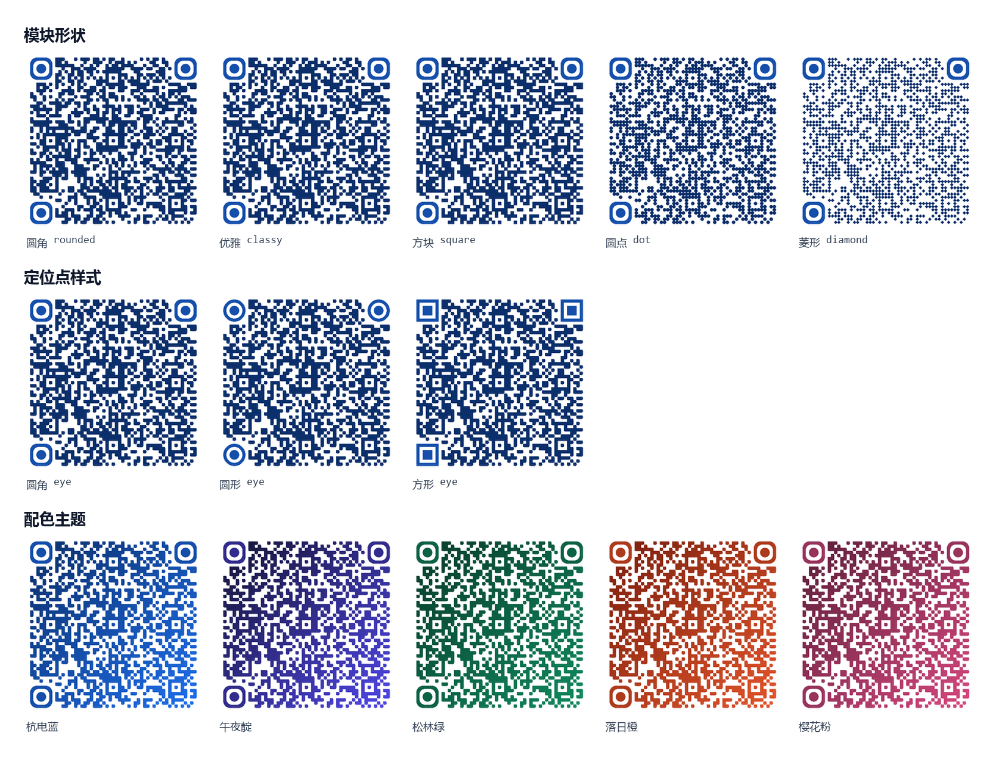
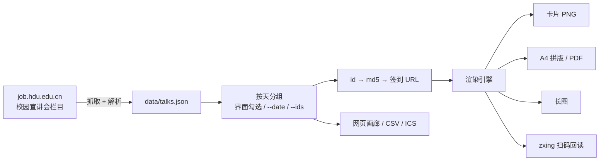

<div align="center">


# 宣讲会签到码

**抓取学校就业网的宣讲会 → 按天挑选 → 生成可打印的签到码。**

[](https://www.python.org/)
[](LICENSE)
[](https://job.hdu.edu.cn/)
[](https://github.com/xkzm123/xuanjqd/stargazers)

[快速开始](#-快速开始) · [界面](#-界面) · [命令行](#-命令行) · [原理](#-原理) · [常见问题](#-常见问题)

</div>

---

## 它做什么

三步，全在本地：

1. **抓** —— 从 `job.hdu.edu.cn` 的「校园宣讲会」栏目抓下最近的场次：编号、时间、公司、地点，全是真实数据；
2. **选** —— 打开本地界面，按天看列表，勾选要去的那几场；或者直接按编号指定数量批量生成；
3. **生成** —— 输出带公司名、时间、地点、编号的二维码卡片，另有 A4 拼版、长图、网页画廊、日历。

二维码里装的就是平台自己的签到链接：

```
http://job.hdu.edu.cn/teachin/qrcode?id={宣讲会编号}&id_code={md5(编号)}&signin=1
```

扫完仍然走平台正常的签到流程 —— 这个工具只负责把链接变成能扫的图。

---

## 🚀 快速开始

**Windows：双击 `start.bat`**

首次运行会自动建虚拟环境、装依赖（约 1–2 分钟），然后弹出界面：

```
http://127.0.0.1:8848
```

macOS / Linux 用 `bash start.sh`。

> 端口被占用会自动往后找空闲端口，控制台会打印实际地址。

---

## 🖥 界面



- 顶部是**抓取时间**和「重新抓取」；
- 中间按天分组，每天一个筛选标签，勾选即可；
- 右侧「已选」显示挑了哪几场，点**生成签到码**出图；
- 下面还有「任意生成」：填起始编号 + 数量，不依赖列表，适合补漏。

生成完直接给出缩略图、网页画廊入口和 zip 下载。

---

## 🧰 命令行

```bash
xuanjqd fetch              # 抓取宣讲会 → data/talks.json，并打印表格
xuanjqd list --date 11-10  # 看已抓到的数据（按天分组）
xuanjqd gen                # 生成抓到的全部
xuanjqd gen --date 11-10   # 只生成某一天
xuanjqd gen --start 137324 -n 5   # 任意生成：从某编号起连续 5 场
xuanjqd preview            # 打开界面
xuanjqd show 137342        # 终端里直接看单个二维码
xuanjqd doctor             # 环境自检
```

### `gen` 常用参数

| 参数 | 默认 | 说明 |
|---|---|---|
| `--date` | — | 只生成某一天，如 `11-10` |
| `--today` | 关 | 只生成今天的 |
| `--ids` | — | 指定编号，逗号分隔，可粘详情页链接 |
| `--start / -s` + `--count / -n` | — | 按编号连续生成任意数量 |
| `--out / -o` | `out` | 输出目录 |
| `--theme / -t` | `hdu` | `hdu` `midnight` `forest` `sunset` `sakura` `mono` |
| `--module` | `rounded` | `square` `rounded` `classy` `dot` `diamond` |
| `--eye` | `rounded` | `square` `rounded` `circle` |
| `--gradient` | 关 | 渐变填充 |
| `--logo` | — | 中心 logo 图片 |
| `--no-card` | 关 | 只出纯二维码 |
| `--pdf / --sheet / --wall` | 开 | A4 拼版、PDF、长图 |
| `--ics` | 关 | 导出日历 |
| `--verify` | 开 | 生成后扫码回读自检 |

---

## 📦 生成的东西

<table>
<tr>
<td width="34%" align="center"><br><sub>单张卡片 · 760×842</sub></td>
<td width="66%" align="center"><br><sub>A4 拼版 · 3×4 · 300 dpi</sub></td>
</tr>
</table>



### 命令行输出



### 样式



---

## 🔍 数据从哪来

`job.hdu.edu.cn` 的详情页和完整列表都要登录，**但首页的「校园宣讲会」栏目是公开的**，一次给出最近的 10 场，带编号、时间、公司、地点 —— 正好够生成签到码。

所以：

- **默认**：抓首页公开数据，不需要任何账号；
- **可选**：如果你有账号，把浏览器里的 Cookie 传给 `--cookie`，会去抓登录后的完整列表页（解析逻辑相同）。

```bash
xuanjqd fetch --cookie "PHPSESSID2=..."
```

也可以把页面另存为 HTML 后离线解析：

```bash
xuanjqd fetch --html 保存的页面.html
```

---

## 🔍 原理



1. 抓首页 HTML，正则取出 `<a href="/teachin/view/id/N">` 里的编号、`<time>` 里的时间、两个 `span` 里的公司和地点；
2. 时间没有年份，按「最近的将来」补全；
3. `id_code = md5(id)`，拼成签到链接；
4. 用 `segno` 算二维码矩阵，自己画模块、定位点、卡片文字；
5. 存 PNG / SVG / PDF；
6. 用 `zxing-cpp` 把图再扫一遍，内容对不上就报错。

**关于扫得出来**：默认 H 级纠错（容忍约 30% 破损），静区固定 4 个模块；测试里对 5 种模块 × 3 种定位点逐一做了反解验证。

---

## ❓ 常见问题

<details>
<summary><b>为什么只有 10 场？</b></summary>

因为没登录。首页只公开最近的 10 场，完整列表在 `/teachin` 后面，需要统一身份认证。想要更多就用 `--cookie` 传登录态。
</details>

<details>
<summary><b>抓到的编号是连续的吗？</b></summary>

不是，中间有空档很正常。用列表里真实的编号生成即可；「任意生成」是给补漏用的，连续编号里不存在的会扫不出来，删掉就行。
</details>

<details>
<summary><b>能换别的学校吗？</b></summary>

能，只要站点结构和签到链接格式一致：改 `xuanjqd/crawl.py` 里的 `BASE` / `HOME_URL`，以及 `codec.py` 里的 URL 模板。
</details>

<details>
<summary><b>双击 start.bat 后浏览器没弹出来？</b></summary>

控制台会打印实际地址（端口被占用会自动换一个），复制到浏览器打开即可。脚本用独立配置目录启动 Edge/Chrome，不会动你正在用的标签页。
</details>

<details>
<summary><b>没装 zxing-cpp 会怎样？</b></summary>

`--verify` 自动跳过并提示，不影响出图。想自检就 `pip install zxing-cpp`。
</details>

---

## 📁 项目结构

```
xuanjqd/
├── start.bat / start.sh     # 一键启动
├── main.py                  # 命令行快捷入口
├── xuanjqd/
│   ├── crawl.py             # 抓取 + 解析宣讲会
│   ├── cli.py               # fetch / list / gen / preview
│   ├── codec.py             # id → md5 → 签到 URL
│   ├── models.py            # 数据模型
│   ├── qr.py                # 渲染引擎
│   ├── layout.py            # A4 拼版 / 长图 / PDF
│   ├── gallery.py           # 网页画廊
│   ├── ics.py               # 日历导出
│   ├── verify.py            # 扫码自检
│   ├── browser.py           # 打开浏览器（避开权限冲突）
│   └── web/                 # 本地界面
├── docs/images/             # README 配图
├── tests/
└── tools/make_assets.py     # 生成配图
```

---

## ⚠️ 说明

- 本项目只做**本地图片生成**：把公开的签到链接渲染成二维码，不登录、不提交、不伪造任何签到记录。
- 扫码后仍然走平台正常的签到流程，是否参加、是否签到由你自己决定，也请遵守学校相关规定。
- 抓取只读首页公开内容，串行、低频；请勿改成高频轮询。

<div align="center">
<br>
<sub>如果这个项目帮你少跑了几趟教学楼，点个 ⭐ 就是最好的支持。</sub>
</div>
