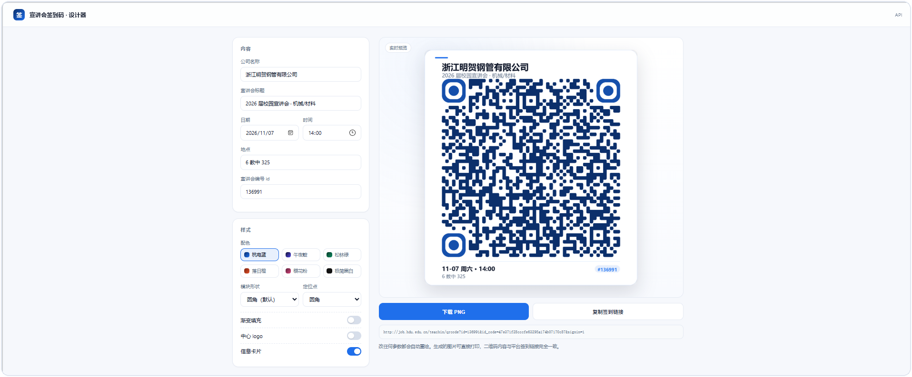
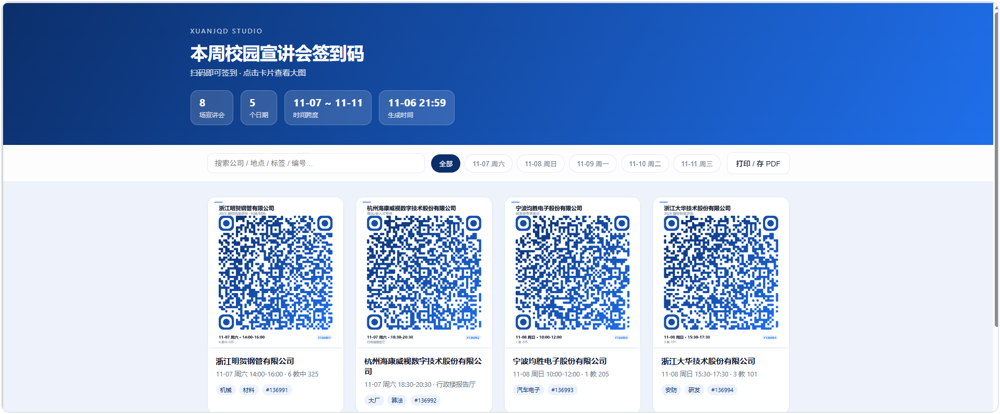
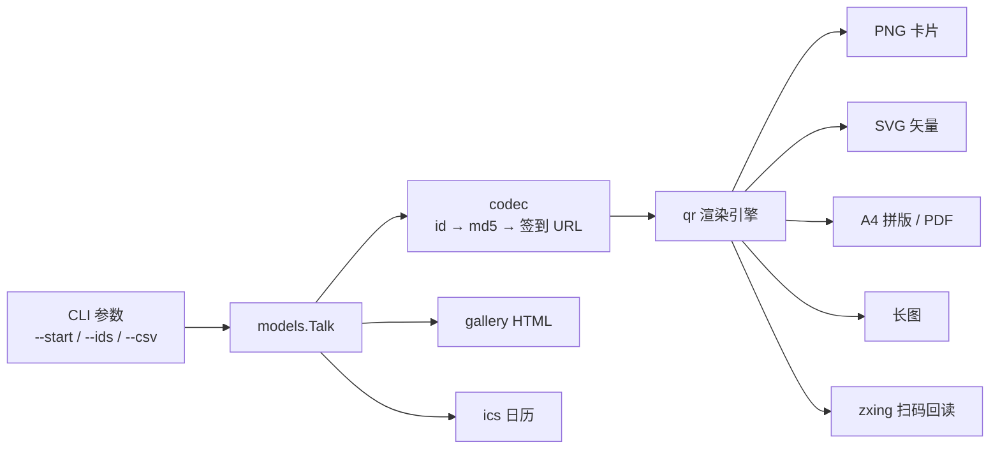

<div align="center">


# 宣讲会签到码工坊

**知道编号，就能把整周的签到码变成可打印的卡片。**

[](https://www.python.org/)
[](LICENSE)
[](https://github.com/xkzm123/xuanjqd)
[](https://github.com/xkzm123/xuanjqd/stargazers)

[快速开始](#-快速开始) · [界面](#-界面) · [命令行](#-命令行) · [原理](#-原理) · [常见问题](#-常见问题)

</div>

---

## 这是什么

杭电（以及任何用同样签到机制的学校）的宣讲会详情页里，藏着一个签到二维码：

```
http://job.hdu.edu.cn/teachin/qrcode?id=136991&id_code=47e371f28cccfe63295a174b07170c87&signin=1
```

`id` 是宣讲会编号，`id_code` 就是 `md5(id)`。所以只要知道编号区间，整周的签到码可以一次性画出来。

这个项目做的就是把这件事做得像样：不是 `pic/` 里一堆黑白方块，而是**带公司名、时间、地点、编号的卡片**——能 A4 打印剪开、能发群里、能在网页里实时调样式，生成完还会自己扫一遍确认没画坏。

> 只做本地图片生成：不登录、不提交、不伪造任何签到记录。

---

## 特性

| | 能力 | 说明 |
|---|---|---|
| 🎨 | **可视化设计器** | 本地网页，左边调参数右边实时出图，满意了直接下载 |
| 🖼️ | **5 种模块 × 3 种定位点 × 6 套配色** | 圆角 / 优雅 / 方块 / 圆点 / 菱形，支持渐变和中心 logo |
| 🖨️ | **A4 拼版 + PDF** | 300 dpi、3×4 排布、带裁切辅助线，打印剪开就能用 |
| 📱 | **长图** | 一张图发班级群，不用来回翻相册 |
| 🌐 | **网页画廊** | 搜索、按日期筛选、点开看大图、一键打印，全离线 |
| ✅ | **扫码自检** | 生成后用 zxing 反解回读，内容和链接对不上会报错 |
| 📅 | **日历导出** | `.ics` 双击导入手机日历，不再记错教室 |
| 🧾 | **清单导出** | `codes.csv` + `manifest.json`，方便二次加工 |
| 🧩 | **CSV 批量导入** | 公司 / 时间 / 地点 / 标签一次填好 |
| 🖥️ | **终端预览** | `xuanjqd show 136991` 直接在命令行里看二维码 |
| 🔌 | **可换学校** | 二维码里只是一条 URL，`--preset` / `--base` 随便换 |

---

## 🚀 快速开始

### Windows：双击 `start.bat`

第一次运行会自动建虚拟环境、装依赖（约 1–2 分钟），装完浏览器自动打开设计器：

```
http://127.0.0.1:8848
```

macOS / Linux 用 `bash start.sh`，效果一样。

### 想直接生成图片？

```bash
# 先看效果（内置演示数据，不访问任何接口）
python -m xuanjqd demo

# 从 136991 开始生成 8 场
python -m xuanjqd gen --start 136991 -n 8

# 精确指定几场（可以直接粘详情页链接）
python -m xuanjqd gen --ids 136991,136995,https://job.hdu.edu.cn/teachin/view?id=136997
```

生成完打开 `out/index.html` 就能看到全部结果。

<details>
<summary>手动安装（不想用脚本）</summary>

```bash
git clone https://github.com/xkzm123/xuanjqd.git
cd xuanjqd

python -m venv .venv
# Windows
.venv\Scripts\activate
# macOS / Linux
source .venv/bin/activate

pip install -r requirements.txt
python -m xuanjqd preview
```
</details>

---

## 🖥 界面

### 可视化设计器

改颜色、改形状、加渐变、加 logo，右边立刻重绘。



### 网页画廊

生成完的 `out/index.html`，支持搜索、按日期筛选、点开看大图、直接打印。



---

## 📦 生成的东西

<table>
<tr>
<td width="34%" align="center"><br><sub>单张卡片 · 760×842</sub></td>
<td width="66%" align="center"><br><sub>A4 拼版 · 3×4 · 300 dpi</sub></td>
</tr>
</table>


### 命令行输出


---

## 🎛 样式


---

## 🧰 命令行

```
xuanjqd gen      批量生成签到码（默认）
xuanjqd demo     用演示数据跑一遍
xuanjqd show     在终端里看单个二维码
xuanjqd preview  启动可视化设计器
xuanjqd doctor   环境自检
xuanjqd themes   列出配色主题
```

### `gen` 常用参数

| 参数 | 默认 | 说明 |
|---|---|---|
| `--start / -s` | `136991` | 起始宣讲会 id |
| `--count / -n` | `6` | 往后生成多少个 |
| `--ids` | — | 精确指定，逗号分隔，可粘链接 |
| `--csv` | — | 从 CSV 读取公司/时间/地点 |
| `--out / -o` | `out` | 输出目录 |
| `--theme / -t` | `hdu` | `hdu` `midnight` `forest` `sunset` `sakura` `mono` |
| `--module` | `rounded` | `square` `rounded` `classy` `dot` `diamond` |
| `--eye` | `rounded` | `square` `rounded` `circle` |
| `--gradient` | 关 | 渐变填充 |
| `--logo` | — | 中心 logo 图片 |
| `--no-card` | 关 | 只出纯二维码 |
| `--sheet / --no-sheet` | 开 | A4 拼版 |
| `--pdf` | 开 | 同时导出 PDF |
| `--wall` | 开 | 长图 |
| `--svg` | 关 | 矢量图 |
| `--ics` | 关 | 日历 |
| `--zip` | 关 | 打包 |
| `--verify` | 开 | 生成后扫码自检 |
| `--json` | 关 | 机器可读输出 |
| `--probe` | 关 | 探测 id 是否有效（慢） |

### CSV 格式

```csv
id,company,title,date,time,end_time,location,url,tags,note
136991,浙江明贺钢管有限公司,2026 届校园宣讲会,2025-11-07,14:00,16:00,6 教中 325,,机械|材料,重点
```

`date` 支持 `2025-11-07`、`2025/11/07`、`11-07`，`tags` 用 `|` 或 `、` 分隔。

---

## 📂 输出结构

```
out/
├── qr/136991.png          # 卡片
├── svg/136991.svg         # 矢量（--svg）
├── sheet/sheet-01.png     # A4 拼版
├── 签到码-A4.pdf          # 可直接打印
├── wall.png               # 长图
├── index.html             # 网页画廊
├── codes.csv              # 清单
├── manifest.json          # 结构化数据
└── talks.ics              # 日历（--ics）
```

---

## 🔍 原理



1. `id_code = md5(str(id))`
2. 拼成 `{base}?id={id}&id_code={code}&signin=1`
3. 用 `segno` 算出二维码矩阵
4. 自己画模块（圆角 / 圆点 / 菱形）、定位点、卡片文字
5. 存成 PNG / SVG / PDF
6. 用 `zxing-cpp` 把图再扫一遍，内容对不上就报错

**关于"扫得出来"**：默认 H 级纠错（容忍约 30% 破损），静区固定 4 个模块，任何样式都不会压到安全线以下；测试里对 5 种模块 × 3 种定位点逐一做了反解验证。

---

## ❓ 常见问题

<details>
<summary><b>怎么找到 start_id？</b></summary>

打开 [杭电 24365 就业数智平台](https://job.hdu.edu.cn/)，在「校园宣讲会」里随便点一场，地址栏的 `id=` 就是。比如 `https://job.hdu.edu.cn/teachin/view?id=136995` 对应 `136995`。宣讲会一般按时间排序，相邻编号往往就是相邻场次。
</details>

<details>
<summary><b>id 是连续的，会不会生成不存在的？</b></summary>

会。编号有空档是正常的，多生成几个不影响，用不上的删掉就行。想精确一点可以加 `--probe` 逐个探测（串行 + 间隔）。
</details>

<details>
<summary><b>换别的学校能用吗？</b></summary>

能，只要签到链接结构一致：

```bash
python -m xuanjqd gen --ids 123 --base https://example.edu/signin \
  --template "{base}?id={id}&code={code}"
```
</details>

<details>
<summary><b>没装 zxing-cpp 会怎样？</b></summary>

`--verify` 自动跳过并提示，不影响出图。想自检就 `pip install zxing-cpp`。
</details>

<details>
<summary><b>为什么默认 scale=12？</b></summary>

53×53 的二维码在 12px/模块时约 636px 宽，A4 上单张约 6cm，手机 20cm 外能稳扫。印海报就调 `--scale 16`。
</details>

---

## 📁 项目结构

```
xuanjqd/
├── start.bat / start.sh     # 一键启动
├── main.py                  # 命令行快捷入口
├── xuanjqd/
│   ├── cli.py               # 命令行
│   ├── codec.py             # id → md5 → URL
│   ├── models.py            # 数据模型 / CSV / 演示数据
│   ├── theme.py             # 配色主题
│   ├── qr.py                # 渲染引擎
│   ├── layout.py            # A4 拼版 / 长图 / PDF
│   ├── gallery.py           # 网页画廊
│   ├── ics.py               # 日历导出
│   ├── verify.py            # 扫码自检
│   ├── sources.py           # 输入解析
│   └── web/                 # 可视化设计器
├── docs/images/             # README 配图
├── tests/                   # 测试
└── tools/make_assets.py     # 生成配图
```

---

## ⚠️ 说明

- 本项目只做**本地图片生成**：把公开的签到链接渲染成二维码，不登录、不提交、不伪造任何签到记录。
- 扫码后仍然走平台正常的签到流程，是否参加、是否签到由你自己决定，也请遵守学校相关规定。
- 演示数据里的公司名仅用于展示排版效果。

<div align="center">
<br>
<sub>如果这个项目帮你少跑了几趟教学楼，点个 ⭐ 就是最好的支持。</sub>
</div>
