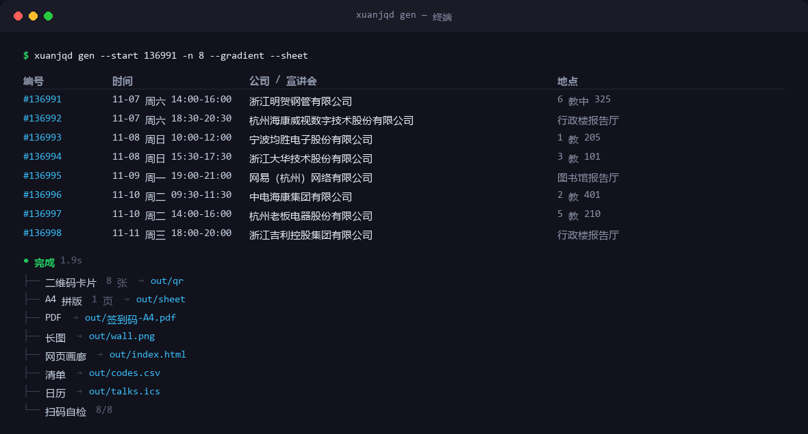
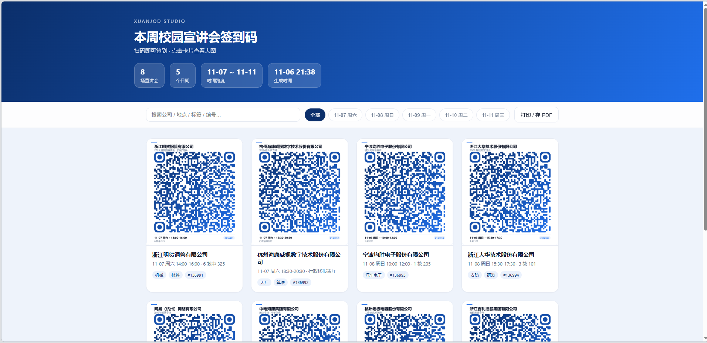
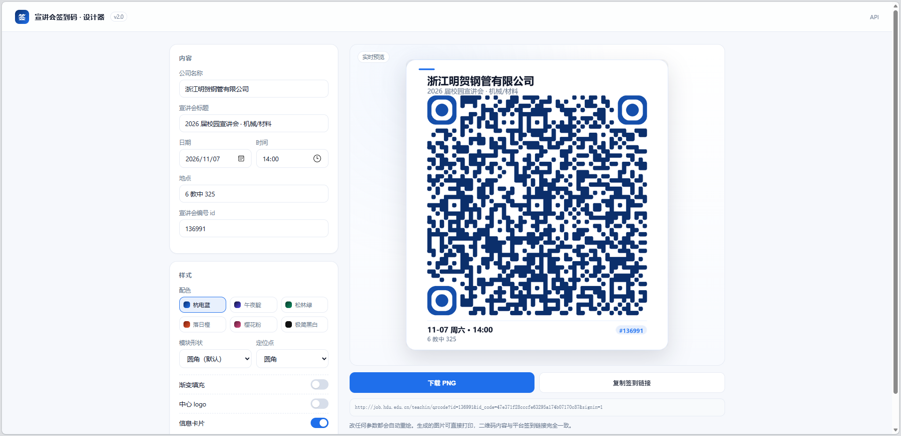
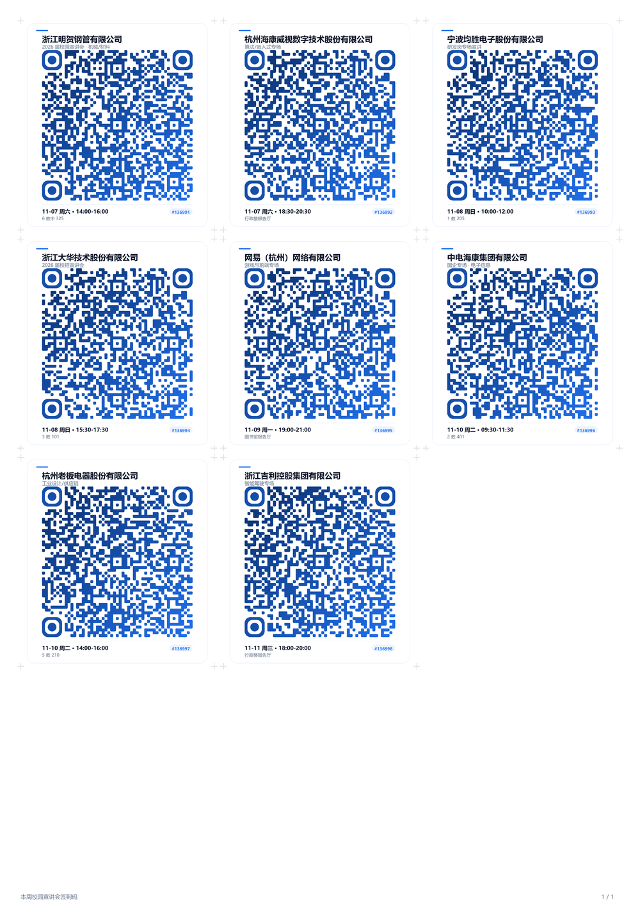
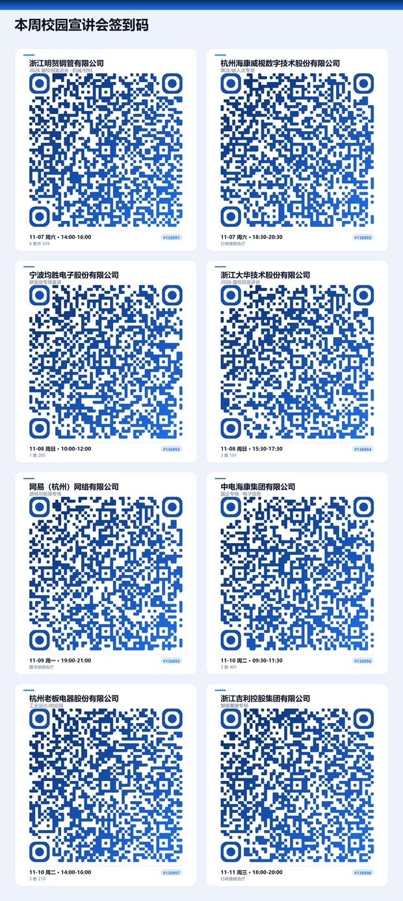
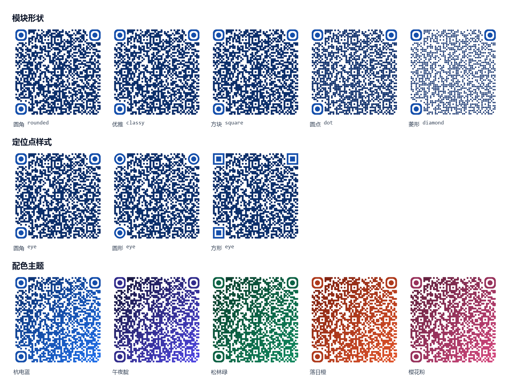
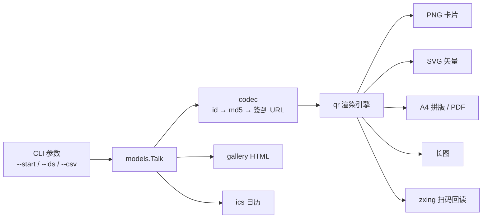

<div align="center">

# 宣讲会签到码工坊 · xuanjqd Studio

**一条命令，把一整周的宣讲会签到码变成可打印的卡片、A4 拼版、网页画廊和日历。**

[](https://www.python.org/)
[](LICENSE)
[](https://github.com/xkzm123/xuanjqd)
[](tests/)
[](https://github.com/xkzm123/xuanjqd/pulls)
[](https://github.com/xkzm123/xuanjqd/stargazers)

[快速开始](#-快速开始) · [效果展示](#-效果展示) · [命令行](#-命令行) · [工作原理](#-工作原理) · [常见问题](#-常见问题)

</div>

---

## 这是什么

杭电（以及任何用同样签到机制的学校）的宣讲会详情页里，藏着一个签到二维码。它的地址长这样：

```
http://job.hdu.edu.cn/teachin/qrcode?id=136991&id_code=47e371f28cccfe63295a174b07170c87&signin=1
```

`id` 是宣讲会编号，`id_code` 就是 `md5(id)`。于是只要知道编号区间，就能把一整周的签到码一次性生成出来 —— 这本来就是原版项目在做的事。

**v2 做的事，是把"能用"变成"好用"**：不再是 `pic/` 里一堆光秃秃的黑白方块，而是带公司名、时间、地点、编号的卡片；能直接 A4 打印剪开贴墙；能在本地网页里实时调样式；生成完还会自己扫一遍确认没画坏。

<table>
<tr>
<td width="50%"></td>
<td width="50%"></td>
</tr>
<tr>
<td align="center"><sub>v2 输出的单张卡片</sub></td>
<td align="center"><sub>左边是 v1，右边是 v2</sub></td>
</tr>
</table>

---

## ✨ 特性

| | 能力 | 说明 |
|---|---|---|
| 🎨 | **可视化设计器** | `xuanjqd preview` 打开本地网页，左边改参数右边实时出图，满意了直接下载 |
| 🖼️ | **5 种模块 × 3 种定位点 × 6 套配色** | 圆角 / 优雅 / 方块 / 圆点 / 菱形，支持渐变与中心 logo |
| 🖨️ | **A4 拼版 + PDF** | 300 dpi、3×4 排布、带裁切辅助线，打印出来剪开就能用 |
| 📱 | **长图** | 一张图发班级群，不用来回翻相册 |
| 🌐 | **网页画廊** | 搜索、按日期筛选、点开看大图、一键打印，全部离线可用 |
| ✅ | **扫码自检** | 生成后用 zxing-cpp 反解回读，确认内容和链接一致（没装就自动跳过） |
| 📅 | **日历导出** | 生成 `.ics`，双击导入手机日历，再也不会记错教室 |
| 🧾 | **清单导出** | `codes.csv` + `manifest.json`，方便二次加工 |
| 🧩 | **CSV 批量导入** | 公司 / 时间 / 地点 / 标签一次填好，生成时自动套用 |
| 🖥️ | **终端预览** | `xuanjqd show 136991` 直接在命令行里看二维码 |
| 🔌 | **可换学校** | 二维码里装的只是一条 URL，`--preset` / `--base` / `--template` 随便换 |
| 🧪 | **27 个测试** | 编码、渲染、解码回读、拼版、导出全覆盖 |

---

## 🚀 快速开始

```bash
git clone https://github.com/xkzm123/xuanjqd.git
cd xuanjqd/xuanjqd-studio

python -m venv .venv
# Windows
.venv\Scripts\activate
# macOS / Linux
source .venv/bin/activate

pip install -r requirements.txt
```

先看效果（用内置演示数据，不访问任何真实接口）：

```bash
python -m xuanjqd demo
```

```
● 演示数据已生成
  8 张卡片 · 1 页 A4 · 自检 8/8
  打开：out/index.html
```

然后换成真实的宣讲会编号：

```bash
# 从 136991 开始，往后 8 场
python -m xuanjqd gen --start 136991 -n 8

# 或者精确指定几场（可以直接粘详情页链接）
python -m xuanjqd gen --ids 136991,136995,https://job.hdu.edu.cn/teachin/view?id=136997
```

不想记参数？直接双击 `main.py` 也行：

```bash
python main.py --start 136991 -n 8
```

---

## 📸 效果展示

### 命令行



### 网页画廊

生成完会得到一个 `out/index.html`，双击就能看。支持搜索、按日期筛选、点开看大图、直接打印。



### 可视化设计器

```bash
python -m xuanjqd preview
# → http://127.0.0.1:8848
```

改颜色、改形状、加渐变、加 logo，右边立刻重绘。调好点「下载 PNG」就行。



### A4 拼版



### 长图



### 样式一览



---

## 🧰 命令行

```
xuanjqd gen      批量生成签到码（默认命令）
xuanjqd demo     用演示数据跑一遍
xuanjqd show     在终端里看单个二维码
xuanjqd preview  启动可视化设计器
xuanjqd doctor   环境自检
xuanjqd themes   列出配色主题
```

### `gen` 的常用参数

| 参数 | 默认 | 说明 |
|---|---|---|
| `--start / -s` | `136991` | 起始宣讲会 id |
| `--count / -n` | `6` | 往后生成多少个 |
| `--ids` | — | 精确指定，逗号分隔，可粘链接 |
| `--csv` | — | 从 CSV 读取公司/时间/地点等元信息 |
| `--out / -o` | `out` | 输出目录 |
| `--theme / -t` | `hdu` | `hdu` `midnight` `forest` `sunset` `sakura` `mono` |
| `--module` | `rounded` | `square` `rounded` `classy` `dot` `diamond` |
| `--eye` | `rounded` | `square` `rounded` `circle` |
| `--gradient` | 关 | 渐变填充 |
| `--logo` | — | 中心 logo 图片路径 |
| `--no-card` | 关 | 只出纯二维码 |
| `--sheet / --no-sheet` | 开 | 是否生成 A4 拼版 |
| `--pdf` | 开 | 同时导出 PDF |
| `--wall` | 开 | 生成长图 |
| `--svg` | 关 | 额外导出矢量图 |
| `--ics` | 关 | 导出日历 |
| `--zip` | 关 | 打包 |
| `--verify` | 开 | 生成后扫码自检 |
| `--json` | 关 | 机器可读输出，方便脚本调用 |
| `--probe` | 关 | 逐个请求签到 URL 探测有效性（可选，慢） |

### CSV 格式

```csv
id,company,title,date,time,end_time,location,url,tags,note
136991,浙江明贺钢管有限公司,2026 届校园宣讲会,2025-11-07,14:00,16:00,6 教中 325,,机械|材料,重点
```

`date` 支持 `2025-11-07`、`2025/11/07`、`11-07` 等写法，`tags` 用 `|` 或 `、` 分隔。

---

## 🔍 工作原理



一句话版本：

1. `id_code = md5(str(id))`；
2. 拼成 `{base}?id={id}&id_code={code}&signin=1`；
3. 用 `segno` 算出二维码矩阵；
4. 自己画模块（圆角 / 圆点 / 菱形）、定位点、卡片文字；
5. 存成 PNG / SVG / PDF；
6. 最后用 `zxing-cpp` 把图再扫一遍，内容对不上就报错。

**关于"扫得出来"这件事**：默认使用 H 级纠错（可容忍约 30% 破损），静区固定 4 个模块，任何样式都不会压缩到安全线以下；测试里对 5 种模块形状 × 3 种定位点逐一做了反解验证。

---

## 📁 项目结构

```
xuanjqd-studio/
├── main.py                 # 一键版入口（兼容老用法）
├── xuanjqd/
│   ├── cli.py              # 命令行
│   ├── codec.py            # id → md5 → URL
│   ├── models.py           # 数据模型 / CSV / 演示数据
│   ├── theme.py            # 配色主题
│   ├── qr.py               # 渲染引擎（圆角、渐变、logo、卡片）
│   ├── layout.py           # A4 拼版 / 长图 / PDF
│   ├── gallery.py          # 网页画廊
│   ├── ics.py              # 日历导出
│   ├── verify.py           # 扫码自检
│   ├── sources.py          # 输入解析 / 可选探测
│   └── web/                # 可视化设计器
├── docs/images/            # README 配图
├── tests/                  # 27 个测试
└── tools/make_assets.py    # 生成 README 配图
```

---

## ❓ 常见问题

<details>
<summary><b>怎么找到 start_id？</b></summary>

打开 [杭电 24365 就业数智平台](https://job.hdu.edu.cn/)，在「校园宣讲会」列表里随便点一场，地址栏里的 `id=` 就是，比如 `https://job.hdu.edu.cn/teachin/view?id=136995` 对应 `136995`。

宣讲会一般按时间排序，所以相邻编号往往就是相邻场次。
</details>

<details>
<summary><b>id 是连续的，会不会生成不存在的？</b></summary>

会。编号有空档是正常的，多生成几个不影响使用 —— 扫不出来的那些直接删掉就行。想要精确一点可以用 `--probe` 逐个探测（串行 + 间隔，别开太大）。
</details>

<details>
<summary><b>换了别的学校还能用吗？</b></summary>

能，只要签到链接的结构一致。二维码里装的永远只是一条 URL：

```bash
python -m xuanjqd gen --ids 123 --preset custom
# 或者直接改模板
xuanjqd gen --ids 123 --base https://example.edu/signin --template "{base}?id={id}&code={code}"
```
</details>

<details>
<summary><b>没有装 zxing-cpp 会怎样？</b></summary>

`--verify` 会自动跳过并提示，不影响出图。想要自检就 `pip install zxing-cpp`。
</details>

<details>
<summary><b>为什么默认 `scale=12`？</b></summary>

53×53 的二维码在 12px/模块时约 636px 宽，打印在 A4 上单张约 6cm，手机 20cm 外能稳扫。要印更大的海报就调 `--scale 16`。
</details>

---

## 🗺️ Roadmap

- [x] 卡片式渲染 + 6 套主题
- [x] A4 拼版 / PDF / 长图 / 画廊
- [x] 可视化设计器
- [x] 扫码自检
- [x] 日历导出
- [ ] 批量导入后自动补全公司名（需要登录态，暂缓）
- [ ] 移动端扫码登记（PWA）
- [ ] 一键部署到 GitHub Pages 做在线版设计器

---

## ⚠️ 说明

- 本项目只做**本地图片生成**：把公开的签到链接渲染成二维码，不登录、不提交、不伪造任何签到记录。
- 二维码内容是平台自己的签到地址，扫了之后仍然要走平台正常的签到流程。
- 请把它当**日程整理工具**用：提前知道这周有哪些宣讲会、在哪、几点，别错过。是否参加、是否签到，仍然是你自己的选择，也请遵守学校相关规定。
- 演示数据里的公司名仅用于展示排版效果。

---

<div align="center">

**如果这个项目帮你少跑了几趟教学楼，点个 ⭐ 就是最好的支持。**

[](https://star-history.com/#xkzm123/xuanjqd&Date)

</div>
